# Airflow Lab 1: Wine Clustering Pipeline with a Data Quality Gate

Modified version of [Airflow Lab 1](https://github.com/raminmohammadi/MLOps/tree/main/Labs/Airflow_Labs/Lab_1) from the course repo.

The original lab clusters credit-card customers on 3 columns with K-Means, picks the number of clusters with the elbow method, and predicts a cluster for one test row. This version clusters the Wine dataset, which has known labels, so the choice of k can be checked against the right answer. It adds a data validation gate, picks k by silhouette score, runs settings from trigger-time params, passes only file paths and small metrics between tasks, and writes an HTML dashboard for every run.

Runs locally with Docker Compose. No cloud resources, $0.

## Pipeline

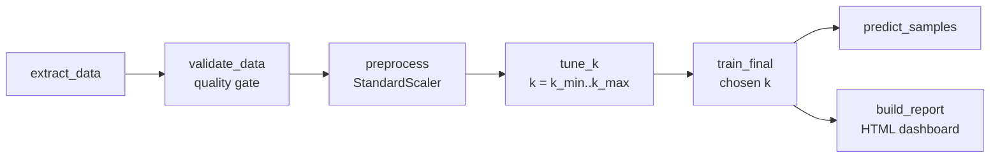

If any validation check fails, `validate_data` raises an error and every task after it is skipped with `upstream_failed`, so no model is trained or reported on bad data.

## What changed from the original

| Area | Original lab | This version |
|---|---|---|
| Dataset | Credit-card customers (8,950 rows), 3 columns used | Wine (178 samples, 13 chemical features, 3 known cultivars) |
| Choosing k | Elbow method only | Silhouette score picks k; elbow reported alongside; both checked against true labels with ARI |
| Pipeline | 4 tasks in a straight line | 7 tasks, ending in 2 parallel tasks |
| Data validation | None | 6 checks (row count, columns, nulls, types, value ranges); failure stops the run |
| Data between tasks | Whole DataFrame as a base64-encoded pickle in XCom | Files in a per-run folder; XCom carries only paths and small metrics |
| Prediction | Saved k=49 model, unscaled input | Chosen-k model, input scaled with the saved scaler |
| Dashboard | None (result printed in a log) | HTML report: elbow and silhouette/ARI charts, PCA cluster plot, cluster profiles, all k tried |
| Run settings | Hardcoded | Typed params (`min_rows`, `k_min`, `k_max`) set from the trigger form |
| Retries and timeouts | 0 retries, no timeout | 1 retry (0 for validation), 10-minute timeout per task |
| Schedule | Not set (behavior depends on Airflow version) | `schedule=None`, manual runs |
| Dependencies | Installed at container start via `_PIP_ADDITIONAL_REQUIREMENTS` | Custom Dockerfile, pinned versions, installed against Airflow's constraints file |
| Airflow version | README sets up 2.5.1, code imports Airflow 3 modules | 2.10.5, with matching imports |
| Admin login | Default credentials in the compose file | Set in `.env`, which is git-ignored |

## Issues found in the original lab

1. **Prediction uses the wrong model.** `build_save_model` fits k = 1 to 49 in a loop and saves only the last fit, so the model used for prediction has 49 clusters, whatever the elbow says.
2. **Prediction input is not scaled.** The model is trained on MinMax-scaled data (0 to 1), but `test.csv` is passed in raw and the scaler is never saved. The test row's `CREDIT_LIMIT` is 241,514, about 8x the training maximum of 30,000.
3. **Rows dropped unnecessarily.** `dropna()` runs on all 18 columns and removes 314 rows (8,950 to 8,636), although only 1 row has a missing value in the 3 columns used.
4. **The full dataset goes through Airflow's database.** Each task passes the whole DataFrame as a base64-encoded pickle in XCom, and unpickling data is a known security risk.
5. **The model is written inside `dags/`,** the folder Airflow scans for DAG code.
6. **Code and setup target different Airflow versions.** The DAG imports `airflow.providers.standard` (Airflow 3), while the README installs 2.5.1. A comment about enabling XCom pickling is also left over, though the code no longer needs it.
7. **No schedule is set,** so the DAG runs daily on Airflow 2 and only manually on Airflow 3.

### Problems hit while building this version

- **Installing packages broke pandas.** The first image build installed scikit-learn, kneed and matplotlib without constraints, pip replaced the image's numpy, and pandas failed with `numpy.dtype size changed`. The Dockerfile now installs against Airflow's official constraints file, which keeps numpy 1.26.4 and pandas 2.1.4 at the image's versions. The original's `_PIP_ADDITIONAL_REQUIREMENTS` approach has the same risk.
- **Run IDs are not valid Windows file names.** Airflow run IDs contain `:` and `+` (`manual__2026-10-31T15:20:01+00:00`), and `working_data/` is mounted from the Windows host, so the code replaces them with `_` when naming each run's folder.

## Results

**Chosen model** (k range 2-10, run `manual__2026-10-31T15:20:01+00:00`, 45 s end to end):

| Chosen k | Silhouette | ARI vs true cultivar | Cluster sizes | Sample predictions |
|---|---|---|---|---|
| 3 | 0.2849 | 0.8975 | 65 / 51 / 62 | 3 of 3 correct |

**Elbow vs silhouette across two runs:**

| k range tried | Silhouette picks | ARI | Elbow picks | ARI |
|---|---|---|---|---|
| 2-10 | 3 | 0.8975 | 4 | 0.7646 |
| 2-6 | 3 | 0.8975 | 3 | 0.8975 |

The elbow's answer changed only because the search range changed: `kneed` locates the knee relative to the curve's endpoints, so moving `k_max` moves the knee. Silhouette scores each k independently and picked 3 both times, which matches the 3 real cultivars. The original lab searched k = 1 to 49, so its elbow result depended on an arbitrary upper bound.

**Clusters match the cultivars' chemistry** (means in original units):

| Cluster | Size | Alcohol | Flavanoids | Color intensity | Proline | Majority cultivar |
|---|---|---|---|---|---|---|
| 0 | 65 | 12.25 | 2.05 | 2.97 | 510 | 1 |
| 1 | 51 | 13.13 | 0.82 | 7.23 | 619 | 2 |
| 2 | 62 | 13.68 | 3.00 | 5.45 | 1100 | 0 |

**Quality gate:** triggering with `min_rows=500` fails `validate_data` with `Data validation failed: ['at least 500 rows (found 178)']`, and the 5 downstream tasks are marked `upstream_failed` without running.

## Screenshots

| | |
|---|---|
| Successful run, all 7 tasks | 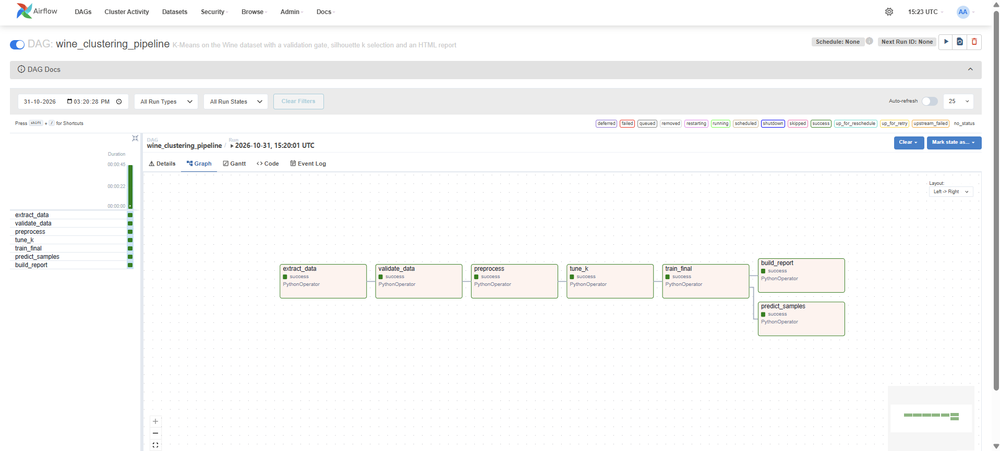 |
| Run details and config | 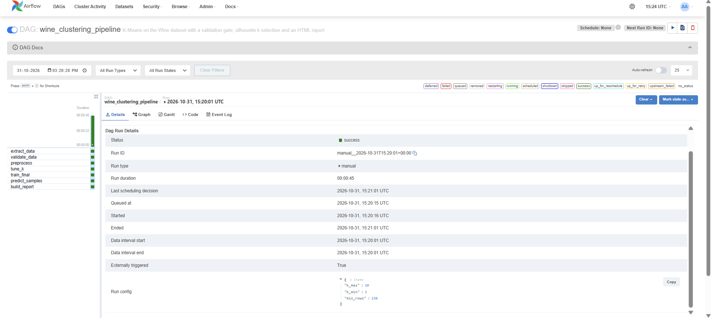 |
| Trigger form with params | 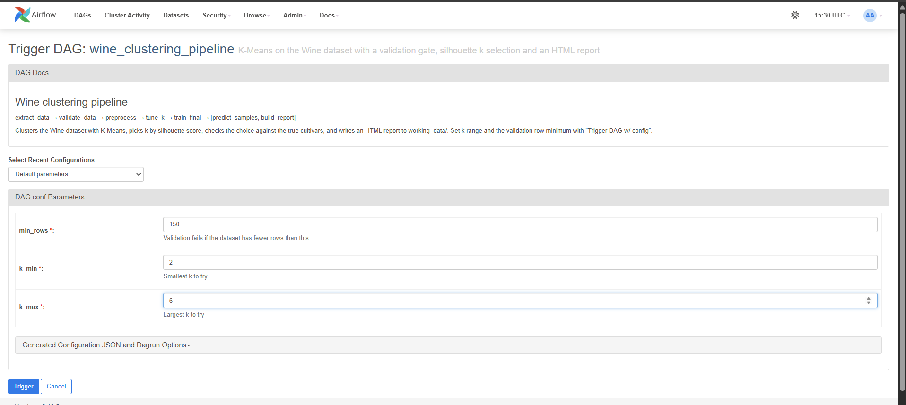 |
| `tune_k` log, k = 2-10 | 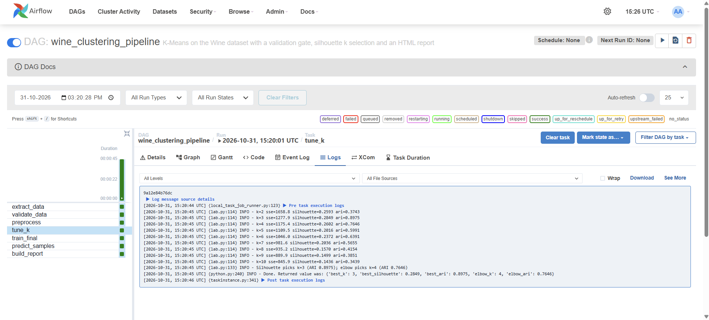 |
| `tune_k` log, k = 2-6 | 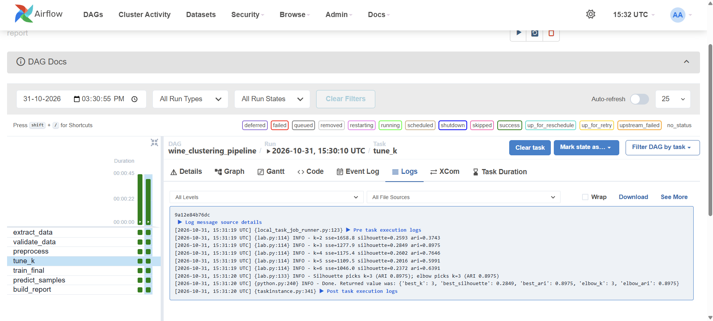 |
| XCom carries only small JSON | 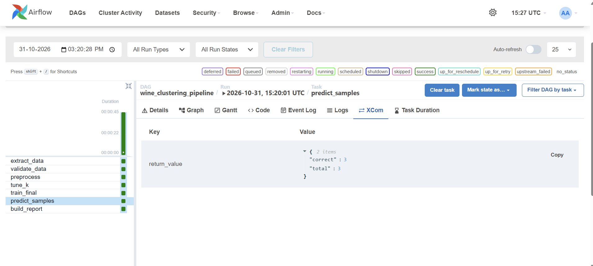 |
| Report: metrics and charts | 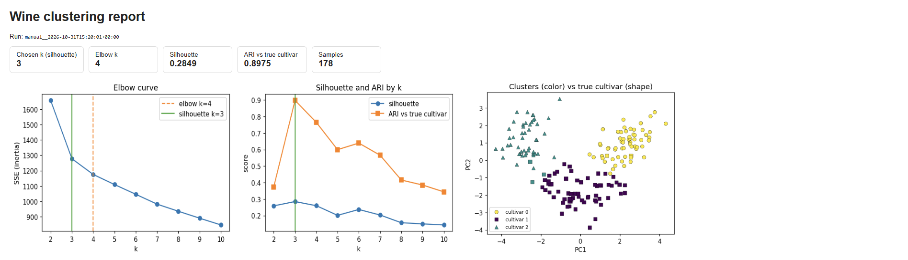 |
| Report: profiles and all k | 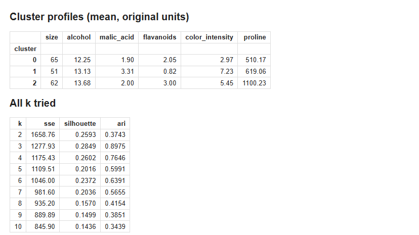 |
| Quality gate failure | 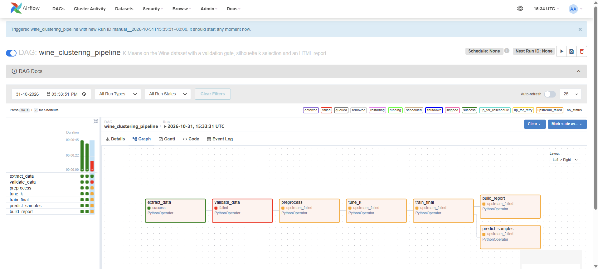 |
| Gate failure log | 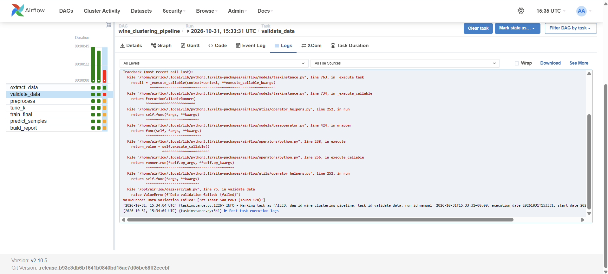 |

## Repo layout

```
dags/
  wine_clustering_dag.py   DAG: 7 tasks, params, retries, timeouts
  src/lab.py               One function per task; reads and writes files, returns small JSON
docker-compose.yaml        Official Airflow 2.10.5 file with 3 edits (build, no examples, working_data mount)
Dockerfile                 Extends apache/airflow:2.10.5, installs requirements against Airflow's constraints
requirements.txt           scikit-learn, kneed, matplotlib (pinned)
.env.example               Variables to copy into .env
screenshots/               Evidence from the runs above
```

Each run writes to `working_data/runs/<run_id>/`: `raw.csv`, `features_scaled.csv`, `scaler.joblib`, `tuning.json`, `model.joblib`, `assignments.csv`, `metrics.json`, `predictions.json` and `report.html`. The latest report is also copied to `working_data/latest_report.html`.

## Run it

Requires Docker Desktop with at least 4 GB of memory for Docker. Tested on Windows 11 with Docker Desktop (WSL 2).

```bash
git clone https://github.com/Khushal070/mlops-airflow-lab.git
cd mlops-airflow-lab
cp .env.example .env          # set your own admin password
mkdir -p logs plugins config working_data
docker compose build
docker compose up airflow-init
docker compose up -d
```

Open http://localhost:8080, log in with the credentials from `.env`, unpause `wine_clustering_pipeline` and trigger it. Stop everything with `docker compose down` (add `-v` to also delete the database).

## Limitations and next steps

- `predict_samples` uses one sample per cultivar taken from the training data, so it checks that the scaler and model are wired together correctly. It is not a held-out accuracy test.
- K-Means is the only algorithm tried; a Gaussian Mixture model with BIC selection would be a natural comparison.
- The pipeline runs manually. A weekly schedule with an alert on validation failure would make it a monitored pipeline.